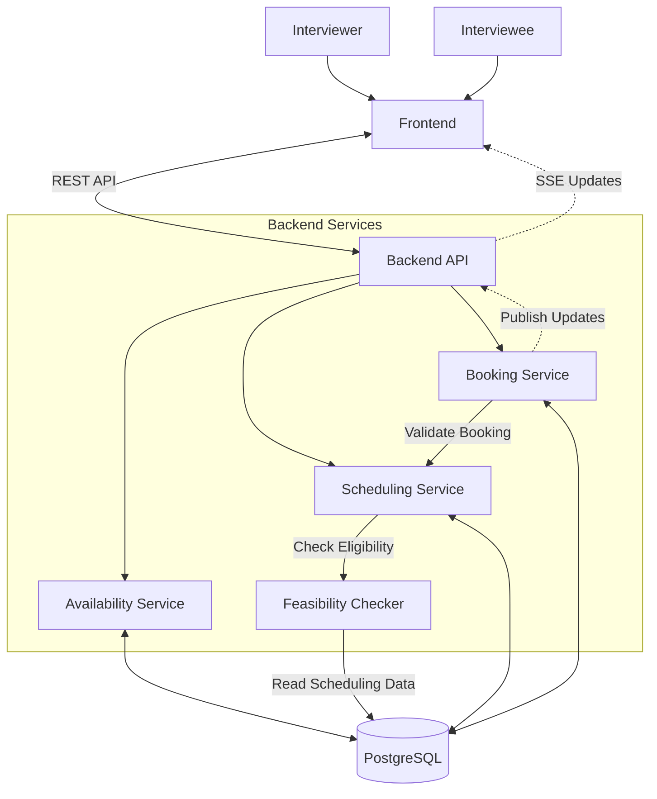

# Architecture

## 1. Overview

The Interview Scheduling System is an internal application that allows interviewers to submit their availability and conflicts of interest (COIs), and interviewees to register for valid interview times.

The system dynamically determines which time blocks are available to each interviewee based on interviewer availability, COIs, and existing bookings. It ensures that every confirmed booking remains feasible without overbooking interviewers.

Final interviewer assignments and workload distribution will be handled by a separate algorithm and are outside the scope of this system.

## 2. Requirements

### Functional Requirements

1. Interviewers can submit and update their availability.
2. Interviewers can declare conflicts of interest with specific interviewees.
3. Interviewee registration opens after interviewer availability and COI data are finalized.
4. Interviewees can view only time blocks that are feasible for them.
5. Interviewees can book and cancel interviews.
6. The system validates each booking to ensure all scheduled interviews remain feasible.
7. The system tracks bookings and provides scheduling data for downstream interviewer assignment.
8. Interviewees receive live updates when scheduling availability changes.

### Nonfunctional Requirements

- **Consistency:** Prevent overbooking and conflicting interview schedules.
- **Concurrency:** Handle simultaneous booking requests safely.
- **Performance:** Provide responsive availability queries for approximately 100 concurrent users.
- **Reliability:** Ensure bookings are stored consistently and persistently.
- **Security:** Restrict users to authorized operations.

## 3. Core Entities

| Entity | Columns | Description |
|---|---|---|
| User | `id`, `name`, `email`, `role` | Represents an interviewer or interviewee. |
| Availability | `id`, `interviewer_id`, `start_time`, `end_time` | Stores time ranges when an interviewer is available. |
| ConflictOfInterest | `id`, `interviewer_id`, `interviewee_id` | Records interviewer–interviewee pairs that cannot be matched. |
| Booking | `id`, `interviewee_id`, `start_time`, `end_time`, `status`, `created_at` | Represents an interviewee's registered interview time. |

Interview slots are not stored as separate entities. Instead, available time blocks are dynamically generated based on interviewer availability and scheduling constraints.

Bookings store actual time intervals rather than referencing predefined slots.

## 4. Core APIs

| Method | Endpoint | Description |
|---|---|---|
| `POST` | `/availability` | Submit interviewer availability |
| `PUT` | `/availability/{id}` | Update availability |
| `POST` | `/conflicts` | Submit conflicts of interest |
| `GET` | `/availability/eligible` | Retrieve feasible interview times |
| `POST` | `/bookings` | Book an interview time |
| `DELETE` | `/bookings/{id}` | Cancel a booking |
| `GET` | `/schedule` | Retrieve a user's schedule |
| `GET` | `/schedule/events` | Subscribe to live scheduling updates |

Additional APIs may be introduced as the application evolves.

## 5. High-Level Architecture

The system follows a **modular monolithic architecture**, consisting of a frontend, backend API, and relational database.

### Architecture Diagram

### Frontend

The frontend provides two primary interfaces:

- **Interviewer Interface:** Submit availability and conflicts of interest.
- **Interviewee Interface:** View eligible interview times, register for interviews, and manage bookings.

The frontend communicates with the backend through REST APIs and receives live scheduling updates through Server-Sent Events (SSE).

### Backend

The backend is organized into three logical services and a shared feasibility-checking component.

**Availability Service**
- Manages interviewer availability.
- Stores and updates conflicts of interest.

**Scheduling Service**
- Dynamically generates potential interview time blocks.
- Determines which time blocks are eligible for each interviewee.
- Uses the Feasibility Checker to validate scheduling constraints.

**Booking Service**
- Creates and cancels interview bookings.
- Coordinates feasibility checks before confirming bookings.
- Prevents concurrent booking conflicts.
- Publishes scheduling updates to connected clients.

**Feasibility Checker**
- Determines whether a proposed booking preserves valid interviewer assignments.
- Considers availability, COIs, existing bookings, and overlapping interview times.
- Does not persist final interviewer assignments.

These components are logical modules within a single backend application rather than independently deployed microservices.

### Database

PostgreSQL serves as the central database, storing users, interviewer availability, conflicts of interest, and confirmed bookings.

The database also supports transactional booking operations to maintain scheduling consistency.

## 6. Core Workflows

### 6.1 Interviewer Registration

1. Interviewers submit their available time ranges.
2. Interviewers declare conflicts of interest.
3. The system stores this information.
4. Once registration data is finalized, interviewee scheduling becomes available.

### 6.2 Interviewee Scheduling

1. An interviewee opens the scheduling interface.
2. The frontend requests eligible interview times.
3. The Scheduling Service generates potential time blocks.
4. The system filters these blocks using interviewer availability, COIs, and existing bookings.
5. Only feasible time blocks are returned to the interviewee.

### 6.3 Interview Booking

1. An interviewee selects an available time block.
2. The Booking Service initiates a transaction and acquires a scheduling lock.
3. The Scheduling Service rechecks feasibility against the latest bookings.
4. If feasible, the booking is confirmed and persisted.
5. Otherwise, the request is rejected.
6. After a successful change, connected clients are notified.

### 6.4 Live Scheduling Updates

The system uses **Server-Sent Events (SSE)** to notify connected interviewees when scheduling availability changes.

Rather than sending personalized availability calculations, the backend broadcasts a scheduling update event. Clients then request their latest eligible time blocks.

SSE improves the responsiveness of the interface, while booking-time feasibility checks remain responsible for correctness.

## 7. Scheduling Feasibility

The system must ensure that every confirmed interview can be supported by available interviewers without conflicts.

Feasibility considers:

- Interviewer availability during the requested interval.
- Conflicts of interest between interviewers and interviewees.
- Existing bookings and overlapping interview times.
- The required number of interviewers per interview.

The Scheduling Service uses a feasibility-checking algorithm to determine whether a proposed booking can be added while preserving valid assignments for all existing bookings.

This check occurs both when retrieving eligible times and when confirming a booking.

The feasibility algorithm may use graph matching or another suitable approach. Its implementation is abstracted from the rest of the system.

## 8. Concurrency and Consistency

Multiple interviewees may attempt to book overlapping times simultaneously. Without synchronization, concurrent requests could independently pass feasibility checks and collectively overbook available interviewers.

For the initial implementation, the system uses **database transactions with a shared scheduling lock** to serialize booking operations.

This ensures that each booking is validated against the latest confirmed scheduling state before being committed.

Given the application's expected scale of approximately 100 concurrent users, this approach prioritizes simplicity and correctness over maximum throughput.